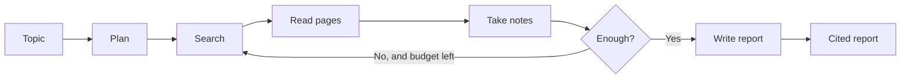

# ResearchPilot

**Give it a topic. An AI agent plans, searches the web, reads pages, takes notes, and writes a cited report.**

[**Live demo**](https://YOUR-VERCEL-URL.vercel.app) · [Demo video](https://YOUR-VIDEO-LINK) · [Report a bug](https://github.com/YOUR-USERNAME/researchpilot/issues)

<!-- Add a screenshot or GIF here. Example:  -->

---

## What it does

You type a research topic. ResearchPilot does the rest:

1. **Plans** the research and breaks the topic into search questions.
2. **Searches** the web for each question.
3. **Reads** the best pages.
4. **Takes notes** and checks if it has enough.
5. **Writes** a clear report with sources for every claim.

You watch every step live while the agent works. When it finishes, the report is saved to your history.

---

## Features

- **Live progress.** See each step (planning, searching, reading, writing) as it happens, streamed to the screen.
- **Cited reports.** Every claim links back to its source page.
- **Three depth modes.** Quick, Standard and Deep. Deeper modes search more and use more AI calls.
- **Hard limits on cost.** Each mode has a maximum number of AI calls per run (4 / 6 / 8). A daily budget stops the app from running past the free quota.
- **Budget meter.** The app shows how much of today's budget is left and when it resets.
- **History.** Past reports are saved per browser. No login needed.
- **Handles errors well.** Clear messages when the server is waking up, the budget is used up, or a search fails.
- **Accessible motion.** All animations switch to simple fades if your device has "reduce motion" turned on.

---

## How the agent works

The agent is a graph built with [LangGraph](https://github.com/langchain-ai/langgraph). Each box is a step. The agent can loop back to search again if its notes are not good enough, but only up to the call limit for the chosen mode.



**Tools the agent can use**

| Tool | What it does |
|------|--------------|
| Web search (Tavily) | Finds relevant pages for a question |
| Page reader (Tavily) | Pulls clean text from a page |

**Why limits matter.** An agent that can loop can also loop forever and burn money. ResearchPilot has a hard cap on AI calls per run and a daily budget for the whole app. These limits are part of the design, not an afterthought.

---

## Tech stack

| Layer | Technology |
|-------|-----------|
| Frontend | Next.js, React, TypeScript, Tailwind CSS |
| Backend | FastAPI (Python) |
| Agent | LangGraph |
| AI model | Google Gemini |
| Web search | Tavily |
| Database | Supabase (Postgres) |
| Hosting | Vercel (frontend), Render (backend) |

---

## Getting started

### What you need

- Node.js 18 or newer
- Python 3.10 or newer
- A [Tavily](https://app.tavily.com) API key (free plan available)
- A [Google AI Studio](https://aistudio.google.com) Gemini API key
- A [Supabase](https://supabase.com) project

### 1. Clone the repo

```bash
git clone https://github.com/YOUR-USERNAME/researchpilot.git
cd researchpilot
```

### 2. Set up the backend

```bash
cd backend
python -m venv .venv
source .venv/bin/activate        # On Windows: .venv\Scripts\activate
pip install -r requirements.txt
cp .env.example .env             # Then fill in your keys
uvicorn main:app --reload
```

The API runs at `http://localhost:8000`.

### 3. Set up the frontend

```bash
cd frontend
npm install
cp .env.example .env.local       # Then fill in the API URL
npm run dev
```

The app runs at `http://localhost:3000`.

### Environment variables

**Backend** (`backend/.env`)

| Variable | Description |
|----------|-------------|
| `GEMINI_API_KEY` | Your Gemini API key |
| `TAVILY_API_KEY` | Your Tavily API key |
| `SUPABASE_URL` | Your Supabase project URL |
| `SUPABASE_SERVICE_ROLE_KEY` | Supabase service role key. **Keep it secret.** Backend only. |
| `ALLOWED_ORIGINS` | Frontend URLs allowed to call the API, separated by commas. No slash at the end. |
| Budget settings | Daily AI call budget and per-mode caps. See `.env.example` for the exact names. |

**Frontend** (`frontend/.env.local`)

| Variable | Description |
|----------|-------------|
| `NEXT_PUBLIC_API_URL` | Your backend URL, for example `http://localhost:8000` |

> Never commit `.env` files. Never put the service role key in the frontend.

---

## Deployment

**Backend on Render**

1. Create a new Web Service from this repo and set the root to `backend/`.
2. Add all backend environment variables.
3. Set `ALLOWED_ORIGINS` to your exact Vercel URL.

**Frontend on Vercel**

1. Import this repo and set the root to `frontend/`.
2. Set `NEXT_PUBLIC_API_URL` to your Render URL.

After you change any environment variable, redeploy that service.

> **Note:** On Render's free plan the server sleeps when idle. The first request can take up to a minute. The app shows a "waking up" message while it starts.

---

## Project structure

```
researchpilot/
├── backend/        # FastAPI app, LangGraph agent, tools, budget guard
├── frontend/       # Next.js app (Home, Research, History, About)
├── docs/           # Design notes and build plan
└── README.md
```

---

## Cost and limits

| Mode | Typical AI calls | Hard cap |
|------|------------------|----------|
| Quick | about 3 | 4 |
| Standard | about 3–4 | 6 |
| Deep | about 4–6 | 8 |

The daily budget is set to about one third of the Gemini daily request limit, so a few heavy users cannot use up the whole quota. It resets at midnight Pacific time. The app shows the reset time in your own timezone.

<!-- After load testing, add real numbers here:
Average AI calls per run: Quick __ · Standard __ · Deep __
Average time per run: Quick __s · Standard __s · Deep __s -->

---

## Known limits

- Reports are stored per browser, not per account. Clearing your browser data loses your history.
- The app depends on free tiers (Gemini, Tavily, Supabase, Render). Heavy use can hit their limits.
- The agent only reads pages it can reach. Paywalled or blocked pages are skipped.
- Like any AI tool, it can make mistakes. Check important claims against the cited sources.
- Do not enter private or sensitive information as a topic.

---

## What I learned

<!-- Write 3 sentences in your own words. Ideas: what is an agent, what is a tool, why limits matter. -->

---

## Author

**YOUR NAME**
[GitHub](https://github.com/deadityah) · [LinkedIn](https://linkedin.com/in/deadityah) · [Portfolio](https://deadityah.github.io/deaditya.github.io)

---

## License

MIT. See [LICENSE](LICENSE).
