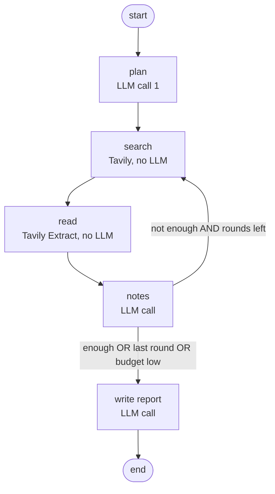

# 01 — ARCHITECTURE

## 1. System overview

```
Browser (Next.js, Vercel)
   │  POST /api/research  (topic, depth, client_id)  ── SSE stream back ──┐
   │  GET  /api/budget, /api/reports, /api/reports/{id}                   │
   ▼                                                                      │
FastAPI (Render) ── budget guard ── LangGraph agent ─┬─ Gemini (plan, notes, write)
        │                                            └─ Tavily (search, extract)
        ▼
Supabase Postgres: reports, usage_daily, usage_monthly
```

Only the backend talks to Gemini, Tavily and Supabase. The browser never sees a secret key.

## 2. The agent graph



| Node | Uses LLM? | Input | Output (written to state) |
|------|-----------|-------|---------------------------|
| `plan` | Yes (structured JSON) | topic, depth limits | `sub_questions`, `queries` (round 1), `outline` |
| `search` | No (Tavily Search, basic depth) | `queries` | `sources` (id, title, url, domain, snippet, score) |
| `read` | No (Tavily Extract) | top-ranked unread sources | `sources[id].content` (truncated) |
| `notes` | Yes (structured JSON) | new sources, previous notes | `notes`, `enough`, `follow_up_queries` |
| `write` | Yes (Markdown) | topic, plan, all notes, source list | `report_md` |

**Why this shape (and not a free-roaming ReAct agent):** a classic ReAct loop makes 1 LLM call per tool decision, roughly 10–20 calls per run. With a small daily free quota that would allow only a handful of runs per day. Here the model still makes the real decisions (what to search, whether it knows enough, what to search next) but each decision is **batched into one structured call per round**. Result: 3–6 calls per run.

**Honest framing for README/interviews:** "plan–act–reflect agent with budget-aware control flow." Stretch idea in Phase 10: add a variant using native Gemini function calling and compare call counts.

**Tools are real tool functions.** `web_search(query)` and `read_pages(urls)` live in `agent/tools.py` as typed functions with docstrings, reusable by any agent.

## 3. Depth presets

| Setting | Quick | Standard | Deep |
|---------|-------|----------|------|
| `max_rounds` | 1 | 2 | 4 |
| `queries_per_round` | 3 | 3 | 4 |
| `results_per_query` | 5 | 5 | 5 |
| `pages_read_per_round` | 3 | 5 | 5 |
| `page_char_limit` | 5000 | 5000 | 5000 |
| Typical Gemini calls | 3 | 3–4 | 4–6 |
| **Hard cap Gemini calls / run** | **4** | **6** | **8** |
| Typical Tavily credits | 4 | up to 8 | up to 20 |
| Report length target | 300–450 words | 500–800 | 900–1300 |

Call math: `1 (plan) + rounds_used (notes) + 1 (write)`. The hard cap leaves room for 1–2 retries after a temporary Gemini error (retries also count).

## 4. Cost-control layers (all required)

1. **Per-run round limit** (`max_rounds`), enforced in the router, not just in prompts.
2. **Per-run Gemini cap** (table above). The guard refuses a `notes` call if only 1 call is left, because that last call is **reserved for `write`**.
3. **Daily Gemini budget** (`DAILY_GEMINI_BUDGET`) stored in Supabase `usage_daily`, day = **America/Los_Angeles** date (Google's quota resets at midnight Pacific).
4. **Monthly Tavily budget** (`MONTHLY_TAVILY_BUDGET`) in `usage_monthly`.
5. **Pre-flight check:** a run only starts if `daily_remaining >= hard_cap` for that depth and Tavily remaining ≥ worst-case credits. Otherwise HTTP 429 with a friendly message.
6. **LangGraph `recursion_limit`** = `3 * max_rounds + 6` (safety net against infinite loops).
7. **Wall-clock timeout** `RUN_TIMEOUT_SECONDS`.
8. **Per-IP rate limit** (`MAX_RUNS_PER_HOUR_PER_IP`) and **one active run per client_id**.
9. **Input caps:** topic ≤ 300 chars; page text truncated to `page_char_limit`; max notes per run 40.
10. **Graceful degrade:** if budget runs out mid-run and ≥1 call remains, jump straight to `write` with notes so far and emit a `warning` event. If 0 calls remain, save the run as `status = "failed_budget"` with notes, emit `error`.

## 5. Shared state (LangGraph)

```
topic, depth, limits{...}
plan: {sub_questions[], outline[]}
round: int (starts 0)
queries: list[str]            # queries for the current round
sources: dict[int, {id,title,url,domain,snippet,score,content|None}]
read_ids: set[int]
notes: list[{id, text, source_ids[], sub_q_index}]
enough: bool
follow_up_queries: list[str]
run_gemini_calls: int
run_tavily_credits: int
warnings: list[str]
report_md: str
```

Source ids are small integers assigned in order of discovery (1, 2, 3 …). These are the numbers used in `[n]` citations. URLs are never written by the LLM; code builds the Sources section.

## 6. Live event stream (SSE) — contract between backend and frontend

Each message is `data: <json>\n\n`. Field `type` decides the shape:

| `type` | Payload | When |
|--------|---------|------|
| `run_started` | `run_id, topic, depth, limits{max_rounds,max_gemini_calls,...}` | start |
| `plan` | `sub_questions[], queries[]` | after plan |
| `round_started` | `round, max_rounds, queries[]` | each round |
| `search_done` | `round, query, results[{id,title,url,domain}]` | per query |
| `reading` | `round, pages[{id,title,domain}]` | before extract |
| `notes` | `round, notes[{id,text,source_ids[]}], enough, follow_up_queries[]` | after notes |
| `writing` | `{}` | before write |
| `report` | `report_md, sources[{id,title,url,domain}]` | final report |
| `usage` | `run_gemini_calls, run_gemini_cap, run_tavily_credits, daily_used, daily_limit` | after every LLM/Tavily call |
| `warning` | `message` | degraded behaviour |
| `error` | `code, message` | failure (see 04 §9) |
| `done` | `report_id, duration_ms` | last event on success |
| `ping` | `{}` | every 15 s (keeps connection alive) |

## 7. Data model (details in 04)

- `reports`: one row per run (topic, depth, status, plan, notes, sources, report_md, stats, client_id)
- `usage_daily(day, gemini_calls)`
- `usage_monthly(month, tavily_credits)`

History is **per browser**: the frontend creates a random `client_id` (UUID) stored in localStorage and sends it with requests. This is **not security**, only organization, so a public demo does not show everyone's reports to everyone. Tell users: "Don't enter private topics."

## 8. Security notes

- **Prompt injection:** web pages can contain text like "ignore your instructions". All page text is wrapped in `<source>` tags and the prompts say it is data only. The agent has **no side-effect tools** (cannot send email, write files, call arbitrary URLs), so the worst case is a bad note, not damage.
- **Abuse of a public demo:** budget guard + per-IP limit + concurrency limit. Optional later: demo access code.
- **Supabase:** Row Level Security ON for all tables, no public policies; only the backend (service role key) accesses data.
- **Links:** Sources open with `target="_blank" rel="noopener noreferrer"`. Only `http(s)` URLs are rendered as links.

## 9. Decisions and reasons

| Decision | Reason |
|----------|--------|
| LangGraph | Appears in AI Engineer job posts; graph, state and routing are exactly the concepts to learn |
| Structured JSON outputs | Reliable parsing, one call per round |
| Tavily | Built for agents; returns clean text; free 1,000 credits/month; 1 credit per basic search, 1 credit per 5 pages extracted |
| Sources section built by code | LLMs invent URLs. Code only lists sources that were really retrieved and actually cited |
| Separate Google AI Studio project/key | Gemini limits are per **project**; sharing with DocuMind would let one app starve the other |
| Budget stored in DB (not memory) | Render restarts/sleeps would otherwise reset counters |
| SSE over POST + fetch | Needs a request body; `EventSource` only supports GET |
| Midnight-Pacific budget day | Matches Google's quota reset, so the meter is truthful |
